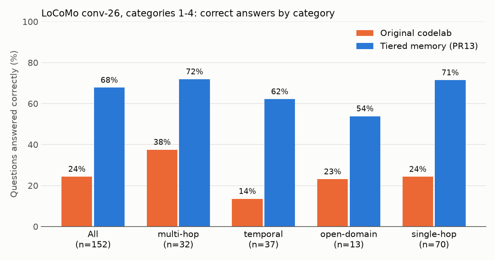
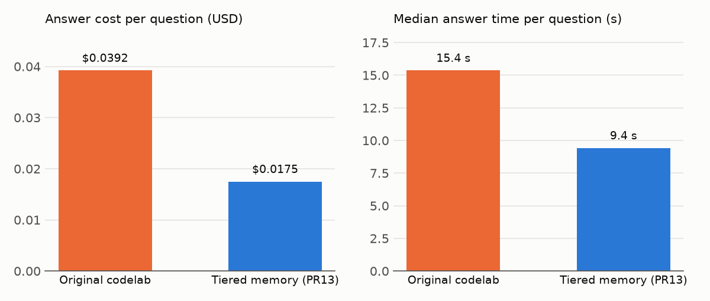

# LoCoMo locomo-001: tiered memory vs the original codelab

On one long LoCoMo conversation, the tiered memory in this repository (PR13, Retain + Recall)
answers **103 of 152** questions correctly. The original codelab answers **37 of 152**. It also
answers each question at less than half the cost and in about 40% less time.

Run on 2026-11-08. Code: commit `d43542a` on the `recall` branch (PR13 plus the PR14 fixes).
The later review commit `9e6e9ee` doesn't change behaviour here. Baseline: the original codelab
as extracted in this repository (`6f343d5`).



## Question

On a conversation long enough that retrieval matters, does the tiered memory answer more
questions correctly than the original codelab, and in which question categories?

LoCoMo conversation `conv-26` has 19 sessions and 419 turns over five months (May-October 2023).
Each question needs one or a few facts out of those 419 turns.

## Setup

- **Data:** `snap-research/locomo` at commit `3eb6f2c`, file `data/locomo10.json`, first conversation
  (`conv-26`). We scored categories 1-4 (152 questions) and left out category 5 (adversarial), as
  Mem0 and Zep do.
- **Input:** each LoCoMo turn becomes one message, with any shared photo kept as its caption text.
  Both systems got identical messages with their session dates. Each system ingested the
  conversation once and answered every question from that memory, without writing anything back.
- **Answering:** each system's normal answer path, with one shared instruction appended to every
  question: answer in at most 6 words, from the conversation only, and give a specific date for
  time questions. Model: Gemini 3.5 Flash.
- **Score:** Mem0's LLM-judge prompt (`ACCURACY_PROMPT`, mem0 v0.1.115), unchanged, with Gemini 3.5
  Flash as the judge instead of gpt-4o-mini. Judge items were shuffled and carried no system name.
  On 20 random items checked by hand, the judge agreed 19 times; the one disagreement went
  against PR13.

## Results

| Category | n | Original | PR13 | Only original right | Only PR13 right | Exact McNemar p |
|---|---:|---:|---:|---:|---:|---:|
| **All (1-4)** | 152 | 37 (24.3%) | **103 (67.8%)** | 8 | 74 | 1.6e-14 |
| 1 multi-hop | 32 | 12 (37.5%) | 23 (71.9%) | 2 | 13 | 0.0074 |
| 2 temporal | 37 | 5 (13.5%) | 23 (62.2%) | 1 | 19 | 4e-5 |
| 3 open-domain | 13 | 3 (23.1%) | 7 (53.8%) | 0 | 4 | 0.125 |
| 4 single-hop | 70 | 17 (24.3%) | 50 (71.4%) | 5 | 38 | 2.5e-7 |

The accuracy gap is +43.4 points (question-level bootstrap 95% CI +34.2 to +52.6). Token F1, the
secondary metric, is 0.174 for the original and 0.413 for PR13.



| Per question | Original | PR13 |
|---|---:|---:|
| Answer cost | $0.039 | $0.017 |
| Answer time, median (p90) | 15.4 s (23.0 s) | 9.4 s (15.1 s) |
| Sequential Gemini calls | 3 | 2 |

PR13 answered faster on 135 of 151 paired questions; its median time is 38.5% lower (95% CI 34-44%).
Ingesting the conversation took 28 minutes for PR13 and 30 for the original. It cost $4.49 for
PR13 and $3.39 for the original. Costs are computed from recorded token usage at $1.50 per million
input tokens and $9 per million output and thinking tokens; they are not invoice totals.

## Why the original loses

After all 419 turns, the original's memory holds **30 entities totalling about 4.9 KB**. Each
entity is keyed by name, and every new mention overwrites its description. Events that don't name
an entity (camping, a pottery class, beach trips, birthdays) are never stored. In 61 of the 74
questions only PR13 got right, the fact needed was not in the original's memory at all, and
in 42 of those the original answered "not mentioned". Temporal questions suffer most because a
relative date survives only inside a description that later sessions replace.

PR13 stores dated facts per message plus consolidated observations, so most of these events
survive.

## Where PR13 still fails

`results/failures-pr13.md` gives one main cause for each of PR13's 49 wrong answers:

| Cause | n |
|---|---:|
| Retain didn't store the detail asked about | 23 |
| Relative date ("last Friday", "last week") resolved wrongly | 7 |
| Refused an open-domain inference ("not specified") | 6 |
| Detail was recalled, but the answer picked the wrong item | 6 |
| Stored fact not recalled | 4 |
| Wrong gold answer or question | 3 |

Most of the Retain misses (15 of 23) come from the second speaker. Retain's extraction prompt is
written for a user and an agent, so it under-extracts the assistant-role speaker's turns. These
are the next things to fix.

## Limits

- **One conversation.** All 152 questions come from `conv-26` and share one memory per system, so
  the tests describe this conversation, not LoCoMo as a whole.
- **Not comparable with published LoCoMo numbers.** Published scores (for example Mem0 66.9,
  Letta 74.0) use other judges, prompts and answer models, so the results differ too much from
  setup to setup to be compared with ours. A fair comparison runs those systems in this harness.
- **Judge family.** The judge is from the same model family as both systems' answer models.
- **Overlap during the run.** PR13's answers ran while the original was ingesting. Per-call timing
  fits show that this did not change per-question latency (`results/latency.json`,
  `per_call_analysis`).

## Files

| Path | Contents |
|---|---|
| `results/scores.json` | Totals, per-category scores and per-question judge verdicts, answers and F1 |
| `results/discordant.json` | Every question only one system got right, with its hand-assigned cause |
| `results/failures-pr13.md` | Cause of each PR13 failure |
| `results/judge-validation.json` | The 20 hand-checked judge items |
| `results/accounting.json`, `results/latency.json` | Cost and timing from recorded usage |
| `results/inputs-manifest.json` | Hashes of the prepared inputs |
| `harness/` | Scripts used for the run: input preparation, the original's runner, judging, scoring, cost, latency, discordant and failure analysis |
| `plots.py` | Draws `figures/` from `results/` |

Question text and gold answers were removed from `results/` because the LoCoMo data is licensed
CC BY-NC 4.0. Join on `question_id` (`conv-26-qNNN` is item NNN, counting from 0 and including category 5, of `conv-26`'s `qa` list) with
`data/locomo10.json` to see them.

The harness is kept as a record of what ran. Its scripts expect the benchmark kit's directory
layout and the shared dev VM, so they won't run from this folder as is. To redraw the figures:

```bash
uv run --with matplotlib python experiments/locomo-001/plots.py
```

The raw run exports (recall traces, prompts, prepared memory snapshots; about 100 MB) are kept
outside the repository, in `benchmark-kit/experiments/locomo-001/` under the
`alloydb-memory-bench` project root.
